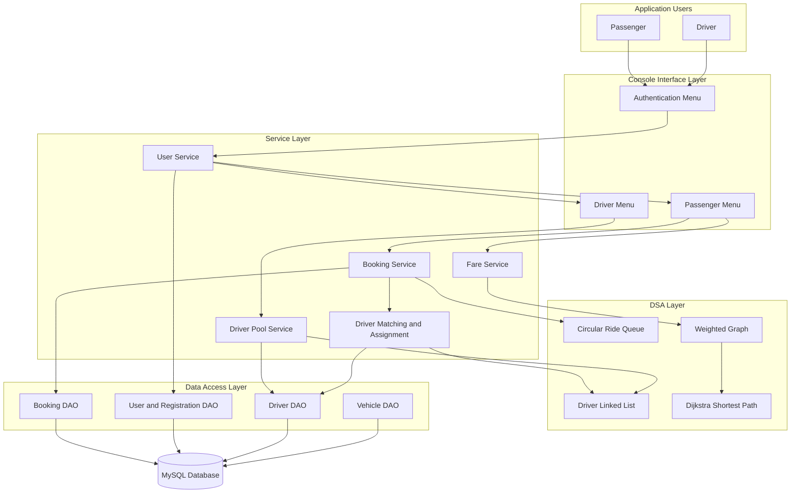
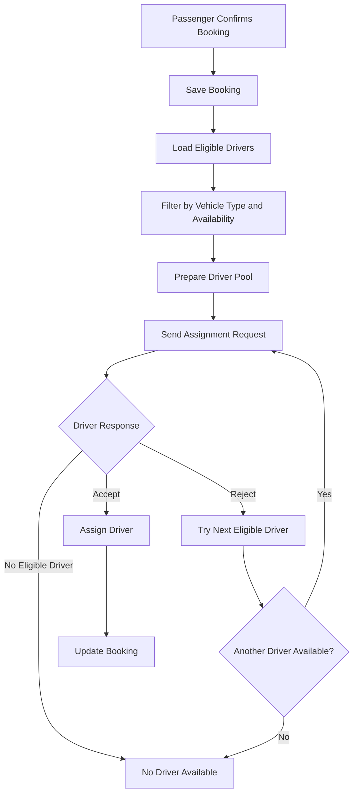
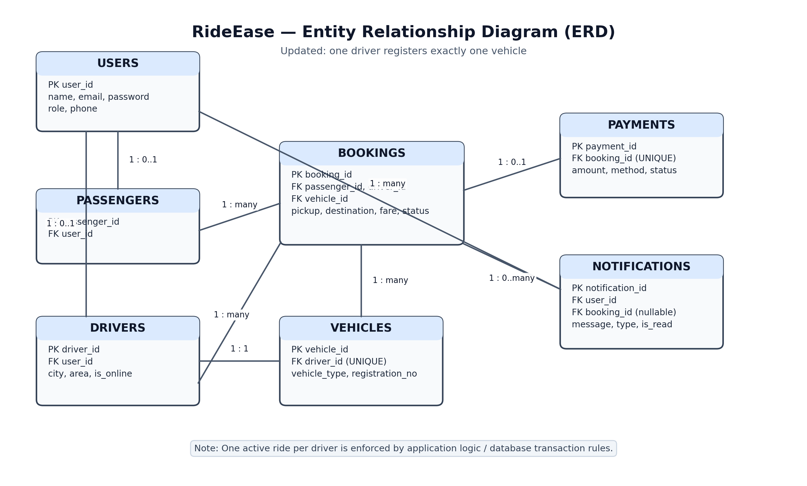
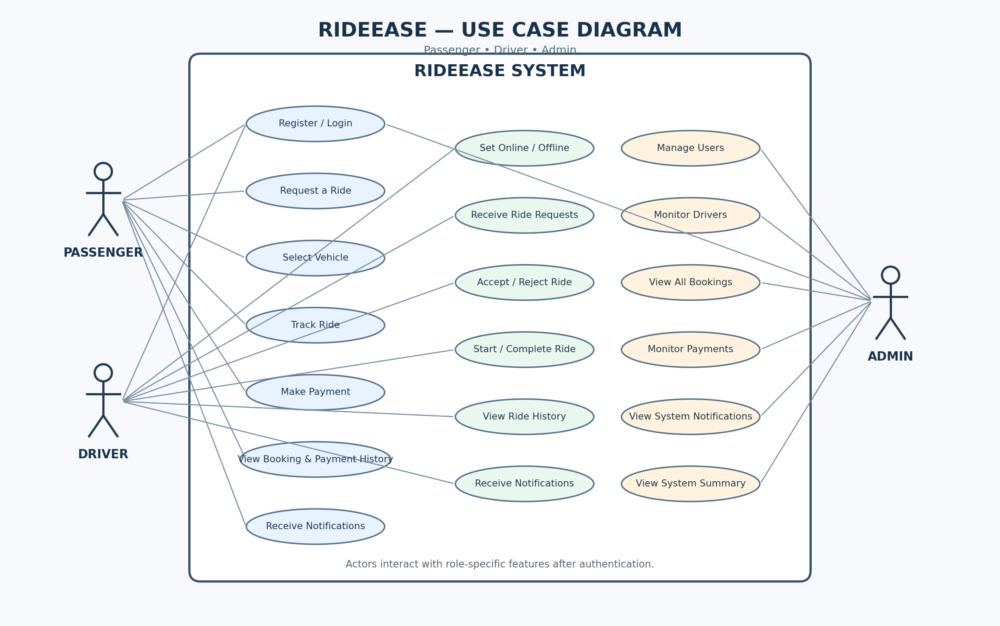

# RideEase — DSA-Based Rickshaw and Cab Booking System

> A Java-based ride-booking application that applies practical Data Structures and Algorithms to passenger booking, driver matching, route calculation, and fare estimation.

---

## 1. Project Overview

RideEase is an academic ride-booking system designed to connect passengers with available rickshaw and cab drivers in Sukkur, Pakistan.

Passengers can register, log in, select pickup and destination locations, choose a vehicle type, view estimated fares, confirm ride requests, and check their booking history.

Drivers can register, log in, manage their availability, receive ride assignment requests, and respond to bookings.

The main objective is to demonstrate how Data Structures and Algorithms can solve practical problems in a transportation system.

**Current implementation:** Java console-based application with MySQL database integration.

### Project Objectives

- Develop a functional ride-booking application.
- Implement selected data structures and algorithms in Java.
- Apply DSA to driver management, booking, and route calculation.
- Integrate Java application logic with a MySQL database.
- Implement passenger and driver workflows.
- Practice software development, testing, debugging, Git, and GitHub collaboration.
- Demonstrate the practical use of DSA through a working application.

### Project Scope

The current implementation focuses on the core booking workflow, driver availability, driver assignment, fare estimation, and shortest-route calculation using predefined locations.

A web frontend, REST API, live GPS tracking, and administrator dashboard are not part of the current working console implementation. They may be considered future enhancements.

---

## 2. System Architecture

RideEase follows a layered Java application architecture. The console interface communicates with service classes, which use DAO classes to interact with the MySQL database.



### How the System Works

1. A passenger or driver registers an account.
2. The user logs in through the authentication menu.
3. The application identifies the user's role.
4. The passenger selects pickup, destination, and vehicle type.
5. The fare service calculates an estimated route distance and fare.
6. The passenger confirms the booking.
7. The booking service saves the request.
8. The driver pool and matching services search for an eligible driver.
9. The assignment workflow handles driver responses and retries.
10. Booking information is stored in MySQL and can be viewed through booking history.

---

## 3. Application Modules

The current system is organized into the following modules.

### Module 1 — Authentication and User Management

**Purpose:** Manage user accounts and provide role-based application access.

Features:
- Passenger registration.
- Driver registration.
- User login.
- Input validation.
- Role-based navigation.
- User data persistence through MySQL.
- Registration and authentication services.

Main classes:
- `AuthMenu.java`
- `UserService.java`
- `RegistrationDAO.java`
- `UserDAO.java`
- `User.java`
- `UserRole.java`

### Module 2 — Passenger Portal

**Purpose:** Allow passengers to request rides and view booking records.

Features:
- Book a ride.
- Select pickup location.
- Select destination.
- Choose Rickshaw or Cab.
- View estimated fare.
- Confirm a ride request.
- View booking history.
- Logout.

Main class:

`PassengerMenu.java`

### Module 3 — Driver Portal

**Purpose:** Allow drivers to manage availability and respond to ride requests.

Features:
- Driver login.
- Online/offline availability.
- Automatic online status when entering the driver workflow.
- Receive ride assignment requests.
- Accept or reject requests through the assignment response workflow.
- Manage driver availability.
- Logout.

Main class:

`DriverMenu.java`

Driver availability is important because only eligible online drivers should be considered for ride assignment.

### Module 4 — Driver Matching and Assignment

**Purpose:** Find an eligible driver for a passenger's booking.

The system considers:
- Driver availability.
- Vehicle type.
- Driver service area.
- Existing active bookings.
- Driver eligibility.
- Previous assignment attempts.

Main classes:
- `DriverMatchingService.java`
- `DriverPoolService.java`
- `DriverPoolLoader.java`
- `AssignmentRetryManager.java`
- `DriverResponseManager.java`
- `BookingService.java`

### Driver Assignment Workflow



### Module 5 — Location, Route and Fare Management

**Purpose:** Calculate estimated travel distance and fare between supported locations.

Features:
- Predefined Sukkur locations.
- Graph-based location representation.
- Weighted connections between locations.
- Shortest-route calculation.
- Rickshaw fare estimation.
- Cab fare estimation.

Main classes:
- `Graph.java`
- `FareService.java`
- `LocationCatalog.java`

### Module 6 — Database Management

**Purpose:** Store and retrieve application data using MySQL.

Features:
- User records.
- Passenger records.
- Driver records.
- Vehicle records.
- Booking records.
- Payment records.
- Notifications.
- Driver assignment attempts.

Main components:
- `DBConnection.java`
- DAO classes.
- `database/schema.sql`

---

## 4. Data Structures and Algorithms

RideEase demonstrates practical DSA concepts through manually implemented structures and application services.

| Data Structure / Algorithm | Implementation | Application |
|---|---|---|
| Linked List | `DriverLinkedList.java` | Driver collection management |
| Circular Queue | `RideQueue.java` | Ride queue operations |
| Weighted Graph | `Graph.java` | Representing locations and distances |
| Dijkstra's Algorithm | Graph route calculation | Shortest-distance route |
| Priority Queue | Java PriorityQueue in graph processing | Efficient shortest-path processing |
| Driver Matching | `DriverMatchingService.java` | Eligible driver selection |
| Assignment Retry | `AssignmentRetryManager.java` | Reattempting driver assignment |
| Searching | DAO and service operations | Finding users, drivers, and bookings |

### 4.1 Custom Driver Linked List

File: `DriverLinkedList.java`

A linked list is used to manage driver entries dynamically.

Core operations include:
- Insertion.
- Searching.
- Traversal.
- Driver collection management.

### 4.2 Circular Ride Queue

File: `RideQueue.java`

A circular queue demonstrates FIFO-based queue operations and efficient reuse of available array positions.

Core operations include:
- Enqueue.
- Dequeue.
- Peek.
- Empty/full checks.

### 4.3 Weighted Graph

File: `Graph.java`

The graph represents the supported locations as vertices and the connections between them as weighted edges.

Each edge represents a simulated travel distance.

### 4.4 Dijkstra's Shortest Path Algorithm

The graph-based route calculation uses Dijkstra's algorithm to find a shortest-distance route between supported locations.

A priority queue is used to process the next minimum-distance vertex efficiently.

### 4.5 Driver Assignment and Retry

Driver matching and assignment services identify suitable drivers and handle rejection or unsuccessful assignment attempts.

This connects DSA concepts with the actual booking workflow.

### Complexity Analysis

The following are standard expected complexities for the corresponding operations and algorithms.

| Operation | Expected Time Complexity |
|---|---|
| Queue enqueue | O(1) |
| Queue dequeue | O(1) |
| Linked List insertion at head | O(1) |
| Linked List search | O(n) |
| Linked List traversal | O(n) |
| Dijkstra with adjacency list and priority queue | O((V + E) log V) |
| Priority Queue insertion/removal | O(log n) |
| Driver sorting, if applied | O(n log n) |

Where:
- `n` = number of elements.
- `V` = number of graph vertices.
- `E` = number of graph edges.

---

## 5. Technology Stack

### Backend and Application Development

| Technology | Purpose |
|---|---|
| Java 21 | Main programming language |
| Maven | Dependency and build management |
| JDBC | Java and MySQL connectivity |
| MySQL Connector/J 9.5.0 | MySQL database driver |

### Database

| Technology | Purpose |
|---|---|
| MySQL 8 | Persistent application data |
| SQL | Database creation and queries |

### Development Tools

| Tool | Purpose |
|---|---|
| IntelliJ IDEA / VS Code | Java development |
| Git | Version control |
| GitHub | Repository hosting and collaboration |
| PowerShell | Project setup and execution |
| Maven | Compilation and test execution |

### Project Dependencies

The project uses Maven dependencies declared in `pom.xml`, including:
- MySQL Connector/J.
- JavaFX Controls.
- JavaFX FXML.

**Current application entry point:** `com.rideease.app.MainApp`

The current demonstrated interface is console-based.

---

## 6. Database Design

The database name is:

`rideease_db`

The SQL schema is available at:

`database/schema.sql`

### Main Database Tables

| Table | Purpose |
|---|---|
| USERS | Stores user account information |
| PASSENGERS | Stores passenger-specific records |
| DRIVERS | Stores driver details and availability |
| VEHICLES | Stores registered vehicle details |
| BOOKINGS | Stores passenger ride requests |
| PAYMENTS | Stores payment records |
| NOTIFICATIONS | Stores system and ride notifications |
| RIDE_ASSIGNMENT_ATTEMPTS | Tracks driver assignment attempts |

### Entity Relationship Diagram



### Use Case Diagram



### Important Database Rules

- Each user has a unique user ID.
- User email and phone are unique.
- Passenger records are associated with user accounts.
- Driver records are associated with user accounts.
- Each registered vehicle belongs to a driver.
- Bookings are associated with passengers.
- An assigned driver and vehicle are linked to a booking when available.
- Booking status is stored in the database.
- Driver assignment attempts are recorded separately.
- Fare values are validated through database constraints.

### Database Security

The application does not hardcode database passwords in Java source files.

Database credentials are read through environment variables:

- `RIDE_DB_USERNAME`
- `RIDE_DB_PASSWORD`

---

## 7. Booking and Fare Management

### Supported Locations

The current prototype includes the following predefined locations:

| No. | Location |
|---|---|
| 1 | Sukkur IBA University |
| 2 | Sukkur Railway Station |
| 3 | Sukkur Barrage |
| 4 | Lab-e-Mehran |
| 5 | Shahi Bazaar |
| 6 | Sukkur Airport |

### Fare Estimation

The prototype uses predefined distances and simulated fare rates.

| Vehicle Type | Base Fare | Per Kilometer |
|---|---:|---:|
| Rickshaw | Rs. 50 | Rs. 25 |
| Cab | Rs. 100 | Rs. 45 |

These are demonstration values and are not live commercial fares.

### Booking Statuses

The database supports the following booking statuses:

- `PENDING`
- `ACCEPTED`
- `IN_PROGRESS`
- `COMPLETED`
- `CANCELLED`
- `NO_DRIVER_AVAILABLE`

The assignment workflow updates booking information according to the result of driver matching and response handling.

---

## 8. REST API and Web Architecture — Future Scope

The original project concept considered a web-based application with a frontend, Java REST APIs, and interactive maps.

However, the current working implementation is a Java console application and does not claim to provide these REST endpoints or web dashboards.

Possible future API structure:

| Method | Planned Endpoint | Purpose |
|---|---|---|
| POST | `/api/auth/register` | Register a user |
| POST | `/api/auth/login` | Authenticate a user |
| GET | `/api/drivers/available` | Retrieve available drivers |
| PATCH | `/api/drivers/availability` | Update driver availability |
| POST | `/api/bookings` | Create a ride request |
| GET | `/api/bookings/{id}` | Retrieve booking details |
| PATCH | `/api/bookings/{id}/accept` | Accept a ride |
| PATCH | `/api/bookings/{id}/reject` | Reject a ride |
| PATCH | `/api/bookings/{id}/status` | Update ride status |
| GET | `/api/bookings/history` | Retrieve booking history |

These are proposed future endpoints, not currently implemented REST APIs.

---

## 9. Team Contributions and Responsibilities

RideEase was developed collaboratively. Each team member contributed to different parts of the project.

| Team Member | Main Responsibility | Contributions | Related Files / Components |
|---|---|---|---|
| Qadeer | Data Structures Implementation | Implemented the custom Driver Linked List and Circular Ride Queue for driver and ride management. | `DriverLinkedList.java`, `RideQueue.java` |
| Ayesha | User Model and Authentication | Worked on the User model, authentication validation, and user registration/login service integration. | `User.java`, `UserService.java`, `AuthMenu.java`, `AuthValidationTest.java` |
| Shahnila | Database, Backend Integration, Booking and Testing | Worked on database design and JDBC integration, DAO implementation and integration, Booking and Vehicle models, booking management, fare estimation, graph-based route calculation, driver pool and assignment integration, passenger and driver menus, testing, debugging, and final project integration. | `schema.sql`, `DBConnection.java`, DAO classes, `Booking.java`, `Vehicle.java`, `BookingService.java`, `FareService.java`, `Graph.java`, `DriverPoolService.java`, `PassengerMenu.java`, `DriverMenu.java`, test classes |

### Shahnila — Detailed Contributions

| Area | Contribution |
|---|---|
| Database Design | Designed and maintained the MySQL database schema and relationships. |
| JDBC Integration | Configured secure database connectivity through environment variables. |
| DAO Layer | Developed and integrated data-access operations for application entities. |
| Booking Model | Worked on booking data structure and persistence. |
| Vehicle Model | Worked on vehicle information and DAO integration. |
| Booking Service | Integrated ride creation and driver assignment workflow. |
| Fare Service | Implemented fare estimation and route-distance integration. |
| Graph | Integrated weighted graph-based route calculation. |
| Driver Pool | Integrated driver availability and driver pool loading. |
| Driver Assignment | Integrated matching, response, and retry workflow. |
| Passenger Portal | Implemented the passenger console workflow and booking history. |
| Driver Portal | Implemented driver console workflow and availability management. |
| Testing | Worked on DAO, service, database, and integration testing. |
| Final Integration | Compiled, debugged, tested, and integrated project components. |
| GitHub | Maintained feature branch, commits, and project integration workflow. |

### Team Collaboration

- Work was organized through individual Git branches.
- Team members developed their assigned components.
- Components were integrated into the shared project.
- Testing and debugging were performed during integration.
- GitHub was used for source control and collaboration.

---

## 10. Project Development and Implementation Phases

| Phase | Work | Status |
|---|---|---|
| Phase 1 | Requirements and project planning | Completed |
| Phase 2 | Database design and schema | Implemented |
| Phase 3 | Java project and Maven setup | Implemented |
| Phase 4 | User models and authentication | Implemented |
| Phase 5 | Custom linked list and circular queue | Implemented |
| Phase 6 | DAO and MySQL integration | Implemented |
| Phase 7 | Passenger booking workflow | Implemented |
| Phase 8 | Driver availability and assignment | Implemented |
| Phase 9 | Graph-based route and fare calculation | Implemented |
| Phase 10 | Integration and testing | In progress / verify final test results |
| Future | Web frontend and REST API | Planned |
| Future | Interactive map and live GPS | Planned |
| Future | Admin dashboard | Planned |

---

## 11. Testing and Validation

The repository contains test classes for different application components.

### DAO and Database Tests

- `DBConnectionTest.java`
- `UserDAOTest.java`
- `PassengerDAOTest.java`
- `DriverDAOTest.java`
- `VehicleDAOTest.java`
- `BookingDAOTest.java`
- `PaymentDAOTest.java`
- `NotificationDAOTest.java`
- `AssignmentAttemptDAOTest.java`

### Model and Service Tests

- `UserTest.java`
- `PassengerTest.java`
- `DriverTest.java`
- `AuthValidationTest.java`
- `DriverMatchingServiceTest.java`
- `DriverPoolLoaderTest.java`
- `AssignmentRetryManagerTest.java`
- `AssignmentRetryManagerAttemptsTest.java`
- `DriverResponseManagerTest.java`

### DSA Demonstrations

- `DriverLinkedListDemo.java`
- `RideQueueDemo.java`

### Run Tests

```powershell
mvn test
```

Some database-related tests may require a running MySQL service and valid database credentials.

---

## 12. A–Z Installation and Execution Guide

This section explains how to set up and run RideEase from a new Windows computer.

### Prerequisites

Install:

| Software | Required Version |
|---|---|
| JDK | 21 or later |
| Maven | 3.9 or later |
| MySQL Server | 8.0 or later |
| Git | Latest stable version |
| PowerShell | Windows PowerShell |

Verify installations:

```powershell
java -version
javac -version
mvn -version
git --version
mysql --version
```

### Step 1 — Clone the Repository

Open PowerShell in the directory where you want the project.

```powershell
git clone -b feature/shahnila-service-integration https://github.com/Shahnila-Chachar/RideEase_CabBooking_System.git
```

Move into the project:

```powershell
cd RideEase_CabBooking_System
```

### Step 2 — Start MySQL

Check MySQL service:

```powershell
Get-Service MySQL80
```

If it is stopped, start it:

```powershell
Start-Service MySQL80
```

Administrator permission may be required.

### Step 3 — Create the Database

The SQL file is:

`database/schema.sql`

From the project root, run:

```powershell
Get-Content -Raw database/schema.sql | mysql -u root -p
```

Enter the MySQL password when prompted.

This creates the `rideease_db` database and its required tables.

### Step 4 — Configure Database Credentials

Run this command:

```powershell
$cred = Get-Credential -UserName "root" -Message "Enter MySQL database password"
```

Then configure:

```powershell
$env:RIDE_DB_USERNAME = $cred.UserName
$env:RIDE_DB_PASSWORD = $cred.GetNetworkCredential().Password
```

The credentials are now available to Java processes launched from this PowerShell window.

**Important:** Every new PowerShell window requires its own credential configuration. Never commit your database password to GitHub.

### Step 5 — Compile the Project

```powershell
mvn clean compile
```

Expected result:

```text
BUILD SUCCESS
```

### Step 6 — Build Runtime Classpath

```powershell
mvn -q dependency:build-classpath "-Dmdep.outputFile=target/classpath.txt"
```

Load the classpath:

```powershell
$classpath = Get-Content "target/classpath.txt" -Raw
```

### Step 7 — Launch RideEase

```powershell
java -cp "target\classes;$classpath" com.rideease.app.MainApp
```

The RideEase welcome banner and authentication menu should appear.

### Step 8 — Use the Application

The authentication menu provides:

1. Register
2. Login
3. Exit

After login, the application opens the appropriate passenger or driver menu according to the account role.

---

## 13. Live Project Demonstration Guide

For a complete booking demonstration, use two separate PowerShell terminals.

### Terminal 1 — Driver Session

1. Open the project in PowerShell.
2. Configure MySQL credentials.
3. Compile the project.
4. Build the runtime classpath.
5. Launch RideEase.
6. Register a driver account if one does not already exist.
7. Log in as a driver.
8. Make sure the driver is ONLINE.
9. Keep the terminal open.

### Terminal 2 — Passenger Session

1. Open another PowerShell window.
2. Navigate to the project directory.
3. Configure MySQL credentials again.
4. Compile the project if required.
5. Build the runtime classpath if required.
6. Launch RideEase.
7. Register a passenger account if one does not already exist.
8. Log in as a passenger.
9. Select Book a Ride.
10. Choose pickup and destination.
11. Select Rickshaw or Cab.
12. Review the estimated fare.
13. Confirm the booking.
14. Observe the driver assignment workflow.
15. Check booking history.

### Important Demonstration Conditions

- The driver must be logged in and online before the passenger confirms a booking.
- The driver must have a registered compatible vehicle.
- The driver must meet the configured service-area requirements.
- An already busy or ineligible driver may not receive another booking.
- If no suitable driver is available, the booking may show `NO_DRIVER_AVAILABLE`.

---

## 14. Presentation-Day Command Support

During the RideEase presentation, ChatGPT can guide the team through the complete setup and execution process step by step.

The team can share the current terminal output and ask for the next exact PowerShell command.

Guidance can cover:

| Presentation Task | Command Support |
|---|---|
| Check project directory | PowerShell navigation commands |
| Verify Java installation | `java -version`, `javac -version` |
| Verify Maven | `mvn -version` |
| Check MySQL | `Get-Service MySQL80` |
| Start MySQL | `Start-Service MySQL80` |
| Create database | Execute `database/schema.sql` |
| Configure credentials | Set environment variables securely |
| Compile application | `mvn clean compile` |
| Build classpath | Maven dependency command |
| Launch application | Java main-class command |
| Driver demonstration | Driver login and availability workflow |
| Passenger demonstration | Booking and history workflow |
| Troubleshooting | Analyze errors and provide the next command |

**The team does not need to memorize every terminal command. ChatGPT can provide A–Z execution guidance during the demonstration, one command at a time, based on the actual terminal output.**

---

## 15. Troubleshooting

### Database Credentials Not Configured

Possible error:

```text
Database credentials are not configured.
```

Solution: Configure both environment variables in the same PowerShell window used to launch the application.

### MySQL Connection Error

Check:

- MySQL service is running.
- Database `rideease_db` exists.
- Username and password are correct.
- MySQL is listening on port 3306.

### No Driver Available

Check:

- Driver is logged in.
- Driver is online.
- Driver has a registered vehicle.
- Vehicle type matches the booking.
- Driver meets the configured service-area requirements.

### Maven Not Recognized

Install Maven and configure its `bin` directory in the Windows PATH.

Restart PowerShell and verify:

```powershell
mvn -version
```

### Java Version Problem

Verify:

```powershell
java -version
javac -version
```

Make sure JDK 21 or later is configured.

### Application Does Not Launch

Try recompiling:

```powershell
mvn clean compile
```

Then rebuild the runtime classpath and launch the application again.

---

## 16. Future Enhancements

The following features can extend RideEase beyond the current academic prototype:

- Web-based passenger and driver portals.
- Spring Boot REST API architecture.
- Administrator dashboard.
- Interactive maps using Leaflet and OpenStreetMap.
- Real-time GPS tracking.
- Live driver location updates.
- Estimated arrival time.
- Ride ratings and reviews.
- Online payment integration.
- Ride scheduling.
- Advanced route calculation using real road data.
- Improved driver ranking using pickup distance and traffic conditions.
- Detailed system analytics.

These are future enhancements and should not be confused with the currently implemented console features.

---

## 17. Project Outcome

RideEase demonstrates the practical application of Data Structures and Algorithms in a transportation booking scenario.

The current project brings together:

- Java 21 application development.
- MySQL database integration.
- User registration and authentication.
- Passenger ride booking.
- Driver availability management.
- Driver matching and assignment.
- Custom linked list and circular queue.
- Weighted graph and shortest-route calculation.
- Fare estimation.
- Booking history.
- Collaborative development and testing.

The main purpose is not only to build a working ride-booking prototype but also to understand how DSA, database management, software architecture, and application development work together.

---

## 18. Repository and Project Information

| Item | Details |
|---|---|
| Project | RideEase |
| Type | DSA Semester Project |
| Language | Java |
| Java Version | 21 |
| Database | MySQL |
| Build Tool | Maven |
| Interface | Console-based |
| Repository | [RideEase on GitHub](https://github.com/Shahnila-Chachar/RideEase_CabBooking_System) |
| Integration Branch | `feature/shahnila-service-integration` |

---

**RideEase — Smart Rides, Smarter Routes.**

*Developed as a collaborative Data Structures and Algorithms semester project.*
