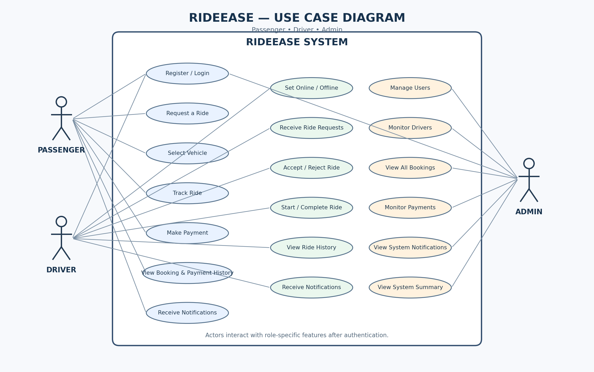
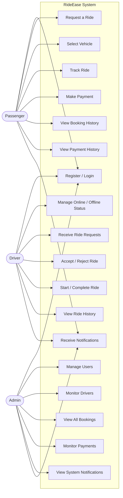
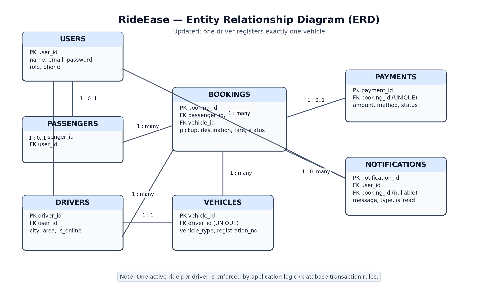
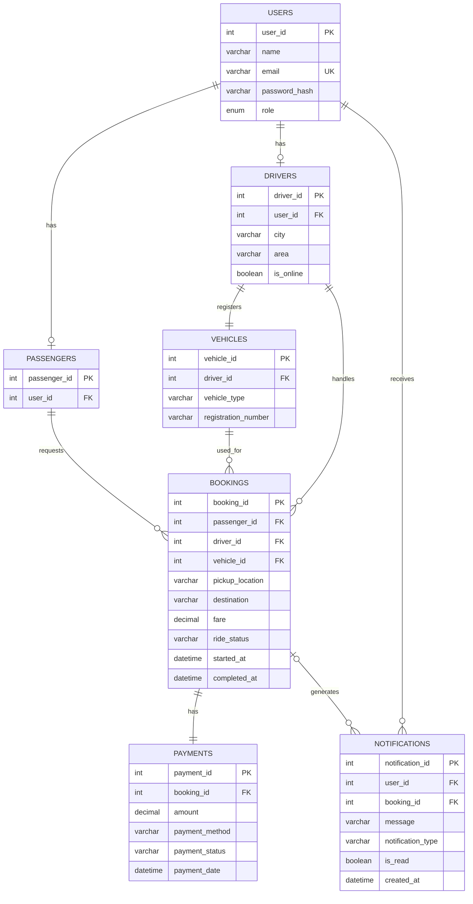

# RideEase — Database Design

## 1. Project Overview

RideEase is a Java-based cab and rickshaw booking system. It allows passengers to request rides, drivers to accept and complete rides, and administrators to monitor the overall system.

The application uses MySQL for permanent data storage and custom Data Structures and Algorithms (DSA) for runtime operations such as ride queue management, driver searching, and route calculation.

## 2. User Roles

The system supports three user roles:

- **Passenger:** Registers, logs in, requests rides, tracks ride status, makes payments, and views booking and payment history.
- **Driver:** Registers, logs in, provides vehicle and service-area details, receives ride requests, accepts or rejects rides, and manages ride status.
- **Admin:** Monitors passengers, drivers, vehicles, bookings, payments, and system notifications.

## 3. Business Rules

1. Every user must have a unique email address.
2. A user can have one of three roles: `PASSENGER`, `DRIVER`, or `ADMIN`.
3. Passwords must be stored as secure password hashes, never as plain text.
4. A passenger can request multiple rides over time.
5. A driver can register only one vehicle.
6. A driver can handle only one active ride at a time.
7. A driver can accept another ride after completing the previous ride.
8. Drivers can manually choose to go online or offline.
9. An offline driver cannot receive new ride assignments.
10. An online driver with no active ride is considered `AVAILABLE`.
11. A driver with an active ride is considered `BUSY`.
12. Driver availability depends on both their online/offline choice and active ride status. No fixed working hours are required.
13. Drivers must provide their city and service area during registration.
14. Passengers select a vehicle type and provide pickup and destination locations when requesting a ride.
15. The system automatically assigns an eligible driver to each ride request.
16. Only online drivers without an active ride and with a matching city, service area, and vehicle type are eligible for assignment.
17. Each eligible driver receives a maximum of one assignment attempt per booking.
18. If a driver rejects a ride request, the system automatically tries the next eligible driver.
19. A driver who rejects a booking must not receive the same booking request again.
20. If all eligible drivers reject the request or no eligible driver is available, the booking status becomes `NO_DRIVER_AVAILABLE`.
21. Once a driver accepts a ride request, the booking is assigned to that driver.
22. A ride must be completed before the passenger can make its payment.
23. Each booking can have only one corresponding payment record.
24. Payment methods include `CASH` and `ONLINE`. Online payment will be simulated in the initial prototype.
25. Payment details and payment history must be stored permanently.
26. Passengers and drivers receive notifications about relevant ride and payment events.
27. Admin receives notifications about important system activities and can monitor the overall system.
28. Completed bookings and payment records must remain available in history.
29. A passenger can cancel a booking only while its status is `PENDING`. Once a driver accepts the booking, the passenger cannot cancel it through the initial prototype.
30. Every payment must have a status: `PENDING`, `SUCCESSFUL`, or `FAILED`.
31. A payment is marked as `SUCCESSFUL` only after the payment has been received or the simulated online payment succeeds.
32. Each driver assignment request has a response timeout of 30 seconds. If the driver does not respond within this time, the attempt becomes `EXPIRED`, and the system tries the next eligible driver.

33. Offline drivers must not receive ride assignment requests.

34. If no eligible drivers remain after rejection or expiration of requests, the booking status becomes `NO_DRIVER_AVAILABLE`.

## 4. Database Entities

The proposed database contains the following entities:

1. Users
2. Passengers
3. Drivers
4. Vehicles
5. Bookings
6. Payments
7. Notifications

- Stores each driver's response to a ride assignment request.
- Tracks whether the request is PENDING, ACCEPTED, REJECTED, or EXPIRED.
- Prevents the same driver from receiving the same booking request more than once.

## 5. Use Case Diagram

The following diagram represents the main interactions between the three system actors and RideEase.

## 6. Entity Relationship Diagram (ERD)

The proposed ERD shows the entities and their relationships.

## 7. Database Design Details

Detailed table columns, MySQL data types, primary keys, foreign keys, constraints, and indexes will be finalized in the next section.

## 8. Notes

- Admin accounts are stored in the USERS table with the ADMIN role. A separate Admin table is not required for the current MVP.
- Passwords are stored as password hashes.
- Driver availability is controlled by their online/offline preference and active ride status.
- MySQL stores permanent booking, payment, and notification records.
- Custom DSA implementations handle runtime operations such as ride queues, driver searching, and route calculation.
- The database schema will be finalized before creating SQL tables.