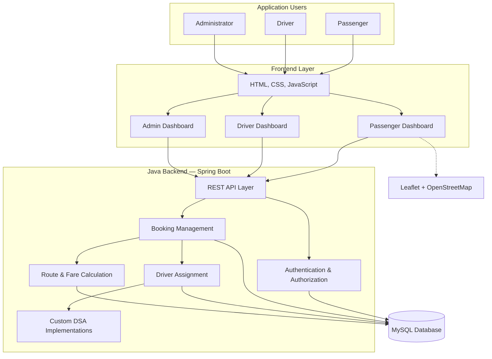
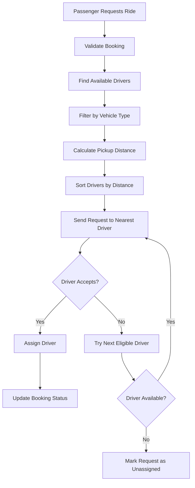
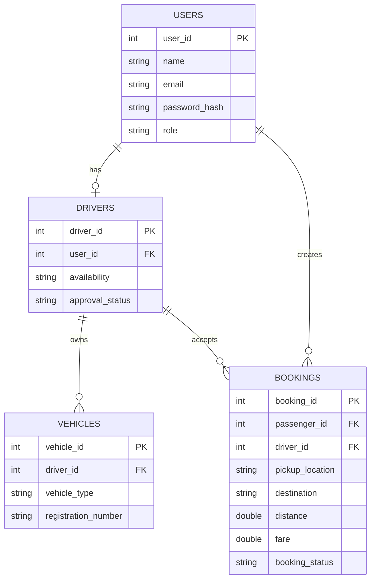

# RideEase — DSA-Based Online Rickshaw and Cab Booking System

> A web-based ride-booking platform that combines practical Data Structures and Algorithms with real-world transportation services.

## 1. Project Overview

RideEase is a web-based application designed to connect passengers with available rickshaw and cab drivers.

Passengers can book rides, select vehicle types, enter pickup and destination locations, and view estimated fares. Drivers can manage their availability, accept or reject ride requests, and update ride statuses.

The project focuses on implementing Data Structures and Algorithms (DSA) in real-world booking scenarios rather than using them only for demonstration.

### Project Objectives

- Develop a functional online ride-booking system.
- Implement selected data structures and algorithms from scratch in Java.
- Apply DSA to driver assignment, booking management, and route calculation.
- Understand client-server architecture, REST APIs, and database integration.
- Develop practical skills in software development, testing, and teamwork.

---

## 2. System Architecture

RideEase follows a client-server architecture in which the frontend communicates with the Java backend through REST APIs.



### How the System Works

1. A passenger submits a ride request through the frontend.
2. The backend validates the request and saves it in the database.
3. The driver assignment module searches for eligible drivers.
4. The DSA layer filters and ranks available drivers.
5. A suitable driver receives the ride request.
6. The driver accepts or rejects the request.
7. The backend updates the booking status and informs the passenger.

---

## 3. Application Modules

The system is divided into six major modules.

### Module 1 — Authentication and User Management

**Purpose:** Manage user accounts and provide secure access to the application.

Features:
- Passenger registration and login.
- Driver registration and login.
- Administrator login.
- Role-based access control.
- Password hashing and validation.
- User profile management.

Main users: Passenger, Driver, Administrator.

### Module 2 — Passenger Portal

**Purpose:** Allow passengers to book and manage rides.

Features:
- Select rickshaw or cab.
- Enter pickup and destination locations.
- View estimated distance and fare.
- Request a ride.
- Track ride status.
- View assigned driver details.
- Cancel a ride according to booking rules.
- View previous bookings and ride history.

### Module 3 — Driver Portal

**Purpose:** Allow drivers to manage their vehicles and ride requests.

Features:
- Register vehicle details.
- Select vehicle type.
- Set availability status.
- Receive matching ride requests.
- Accept or reject ride requests.
- Update ride status.
- View completed rides and ride history.

Driver availability will be managed using the following states:

```text
AVAILABLE
    ↓
REQUEST RECEIVED
    ↓
RIDE ACCEPTED
    ↓
IN PROGRESS
    ↓
COMPLETED
    ↓
AVAILABLE
```

A driver must not be assigned to conflicting active rides.

### Module 4 — Admin Dashboard

**Purpose:** Provide administrative control over the application.

Features:
- View registered passengers and drivers.
- Approve or deactivate driver accounts.
- View registered vehicles.
- Monitor active, completed, and cancelled bookings.
- View basic system statistics.
- Manage user accounts when required.

### Module 5 — Smart Driver Assignment

**Purpose:** Automatically find the most suitable driver for a ride.

The system will:

1. Retrieve available drivers.
2. Filter drivers by vehicle type.
3. Identify drivers eligible for the requested ride.
4. Calculate or retrieve their distance from the pickup location.
5. Rank drivers according to distance.
6. Send the request to the nearest eligible driver.
7. Offer the request to another driver if the first driver rejects or fails to respond.

#### Driver Assignment Workflow



### Module 6 — Location, Route and Fare Management

**Purpose:** Calculate estimated fares and identify routes between locations.

Features:
- Select pickup and destination points.
- Represent locations as nodes in a graph.
- Represent roads as edges.
- Calculate shortest routes.
- Estimate fare using distance and pricing rules.
- Display routes on an interactive map when implemented.

Initial development will use simulated locations and distances. Real map integration will be added as an advanced feature.

---

## 4. Data Structures and Algorithms

The following DSA components will be implemented in Java and integrated into the application.

| Data Structure / Algorithm | Application | Purpose |
|---|---|---|
| Queue | Pending ride requests | Process requests in FIFO order |
| Priority Queue | Optional priority-based requests | Process higher-priority requests first |
| Linked List | Available driver collection | Manage driver entries dynamically |
| HashMap | Users, drivers, and bookings | Retrieve records using unique IDs |
| Graph | Road network | Represent locations and roads |
| BFS | Unweighted road network | Find a path with minimum number of edges |
| Dijkstra's Algorithm | Weighted road network | Find shortest-distance routes |
| Sorting | Driver assignment | Rank eligible drivers by distance |
| Searching | Booking and user management | Find records using IDs or criteria |

### Custom DSA Implementation

Selected data structures and algorithms will be implemented manually in Java rather than relying entirely on Java's built-in collections.

For example:

```text
Queue
 ├── enqueue()
 ├── dequeue()
 ├── peek()
 └── isEmpty()

Linked List
 ├── insert()
 ├── delete()
 ├── search()
 └── display()

Graph
 ├── addNode()
 ├── addEdge()
 ├── BFS()
 └── Dijkstra()
```

### Complexity Analysis

Complexity analysis will be performed for the implemented operations.

| Operation | Expected Complexity |
|---|---|
| Queue enqueue / dequeue | O(1) |
| HashMap average lookup | O(1) |
| Linked List search | O(n) |
| Sorting eligible drivers | O(n log n) |
| BFS using adjacency list | O(V + E) |
| Dijkstra using a priority queue | O((V + E) log V) |

Here, `n` represents the number of records, `V` the number of graph vertices, and `E` the number of graph edges.

---

## 5. Technology Stack

### Backend

| Tool | Purpose |
|---|---|
| Java 21 | Main programming language and DSA implementation |
| Spring Boot | Backend application and REST API development |
| Maven | Dependency management and project builds |
| JDBC / Spring Data JPA | Communication between Java and MySQL |

### Frontend

| Tool | Purpose |
|---|---|
| HTML | Website structure |
| CSS | Styling and responsive layouts |
| JavaScript | Interactive features and API communication |
| Leaflet | Optional interactive map integration |
| OpenStreetMap | Optional map data and visualization |

### Database and Development Tools

| Tool | Purpose |
|---|---|
| MySQL | Store users, drivers, vehicles, bookings, and ride history |
| IntelliJ IDEA | Java development environment |
| Git | Version control |
| GitHub | Repository hosting and team collaboration |
| Postman | Testing REST APIs |
| MySQL Workbench | Database management and query execution |

---

## 6. Database Design

The database will contain the following main entities.



### Important Database Rules

- Each user will have a unique account ID.
- Each driver will have an associated user account.
- Each vehicle will belong to a registered driver.
- Each booking will belong to a passenger.
- An assigned driver will be associated with the booking.
- Booking status and driver availability must remain consistent.
- Passwords will be stored as secure hashes, not plain text.

---

## 7. REST API Structure

The backend will expose REST APIs for communication between the frontend and backend.

| Method | Endpoint | Purpose |
|---|---|---|
| POST | `/api/auth/register` | Register a user |
| POST | `/api/auth/login` | Authenticate a user |
| GET | `/api/drivers/available` | Retrieve available drivers |
| PATCH | `/api/drivers/availability` | Update driver availability |
| POST | `/api/bookings` | Create a ride request |
| GET | `/api/bookings/{id}` | Retrieve booking details |
| PATCH | `/api/bookings/{id}/accept` | Accept a ride |
| PATCH | `/api/bookings/{id}/reject` | Reject a ride |
| PATCH | `/api/bookings/{id}/status` | Update ride status |
| GET | `/api/bookings/history` | Retrieve booking history |

These endpoints represent the planned API structure and may be adjusted during implementation.

---

## 8. Project Development Phases

The project will be developed incrementally to keep the implementation manageable.

| Phase | Tasks | Expected Outcome |
|---|---|---|
| Phase 1 | Requirements, architecture, database design | Project structure and design |
| Phase 2 | Authentication and user management | Login and registration |
| Phase 3 | Passenger and driver dashboards | Basic frontend modules |
| Phase 4 | Booking and fare estimation | Functional ride booking |
| Phase 5 | Custom DSA implementation | Queue, Linked List, HashMap, Graph |
| Phase 6 | Smart driver assignment | Automated driver selection |
| Phase 7 | Route calculation and map integration | Shortest-route visualization |
| Phase 8 | Admin dashboard and testing | Complete integrated application |

---

## 9. Team Task Distribution

Tasks can be divided among team members according to their responsibilities.

| Role | Main Responsibilities |
|---|---|
| Backend Developer | Spring Boot setup, REST APIs, authentication, booking logic |
| DSA Developer | Custom data structures, driver assignment, graph algorithms, complexity analysis |
| Frontend Developer | Passenger, driver, and admin dashboards |
| Database Developer | MySQL schema, relationships, queries, and data validation |
| Integration and QA | API testing, frontend-backend integration, bug fixing, and documentation |

A team member may handle more than one role depending on the group size.

### Shared Responsibilities

- Maintain the GitHub repository.
- Follow a consistent coding structure.
- Test features before merging changes.
- Document implemented DSA operations and their complexities.
- Coordinate integration between modules.

---

## 10. Testing and Validation

The application will be tested at different levels.

### Functional Testing

- Passenger registration and login.
- Driver registration and approval.
- Ride booking and cancellation.
- Fare estimation.
- Driver acceptance and rejection.
- Booking status updates.
- Ride history and admin monitoring.

### DSA Testing

- Queue insertion and removal.
- Linked List insertion, deletion, and searching.
- HashMap lookup by unique ID.
- BFS path traversal.
- Dijkstra shortest-route calculation.
- Driver sorting and assignment.

### System Validation

- Prevent unauthorized access to dashboards.
- Prevent drivers from accepting conflicting rides.
- Validate pickup and destination details.
- Prevent invalid fare calculations.
- Handle cases where no eligible driver is available.
- Verify database updates after every booking status change.

---

## 11. Future Enhancements

The following features may be added after completing the core system:

- Real-time location tracking.
- WebSocket-based ride status updates.
- Interactive maps with real road data.
- Estimated arrival time calculation.
- Ride ratings and reviews.
- Advanced fare calculation.
- Ride scheduling.
- Detailed admin analytics.
- Improved driver assignment using traffic conditions.

---

## 12. Project Outcome

RideEase aims to demonstrate how Data Structures and Algorithms can be used to solve practical problems in a transportation application.

The completed project will combine:

- A functional ride-booking website.
- Passenger, driver, and admin dashboards.
- Java-based DSA implementations.
- Database integration.
- Automated driver assignment.
- Shortest-route calculation.
- REST API communication.

**The primary goal is to build a working ride-booking application while understanding how DSA, backend development, frontend development, and database management work together in a real-world software system.**

---

*Project Status: Planning and design phase.*  
*Technology Stack: Java 21, Spring Boot, MySQL, HTML, CSS, and JavaScript.*
